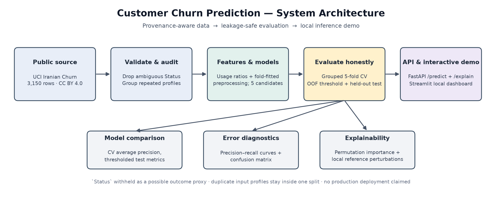
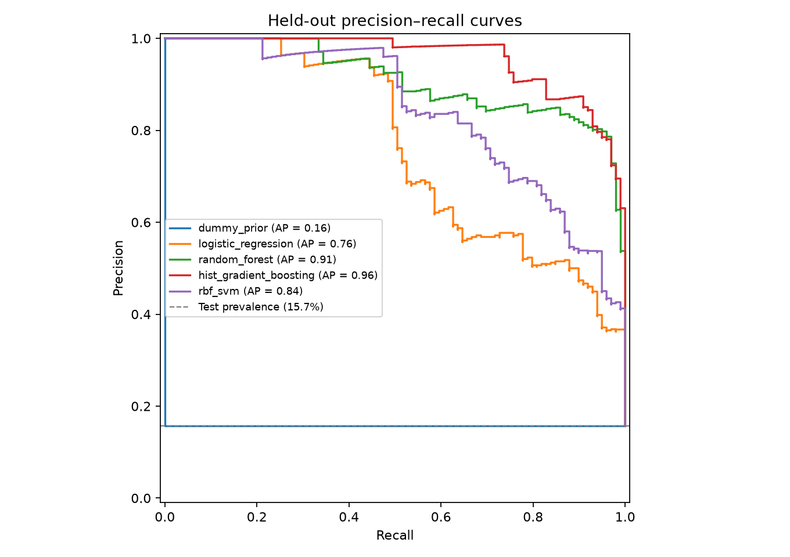
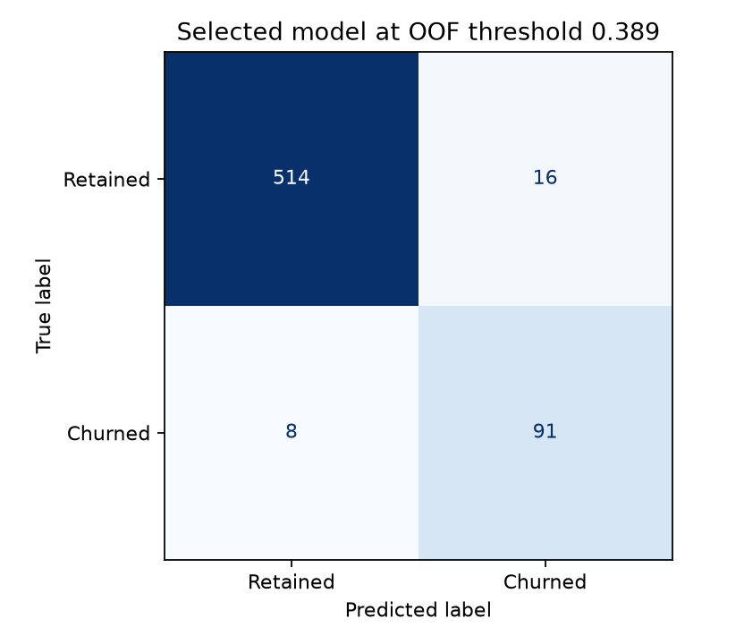

# Customer Churn Prediction

A reproducible end-to-end churn prediction benchmark using the **UCI Iranian Churn** dataset. It includes provenance-aware data loading, grouped validation to keep repeated input profiles apart, engineered usage rates, five candidate models, threshold selection, global and local explanations, a FastAPI service, and a Streamlit demo.

> **Research and education only.** This is a small historical benchmark—not a production retention system. The source is from one Iranian telecom dataset, and the reported metrics do not establish performance on another company, population, time period, or intervention.



## Held-out results

The dataset contains 3,150 rows and 495 churn labels (15.7%). UCI describes usage fields from months 1–9 and a churn label at month 12, with a three-month planning gap. A stratified, group-aware split reserved about 20% as a final test fold; exact repeated profiles across the 12 eligible input fields stay in the same partition. Five-fold grouped CV on the remaining development data selects the model by mean average precision. Each candidate's threshold is selected only from its development out-of-fold predictions by maximum F1.

| Candidate | Grouped CV average precision (mean ± SD) | Held-out average precision | Precision | Recall | F1 |
|---|---:|---:|---:|---:|---:|
| Histogram Gradient Boosting **(selected)** | **0.936 ± 0.032** | **0.957** | **0.850** | 0.919 | **0.883** |
| Random forest | 0.890 ± 0.032 | 0.911 | 0.803 | **0.949** | 0.870 |
| RBF SVM | 0.801 ± 0.022 | 0.839 | 0.684 | 0.808 | 0.741 |
| Class-weighted logistic regression | 0.734 ± 0.056 | 0.762 | 0.538 | 0.778 | 0.636 |
| Prior-only dummy baseline | 0.157 ± 0.002 | 0.157 | 0.157 | 1.000 | 0.272 |

At the selected model's development-only threshold (0.389), the test fold contained 99 churners and 530 retained customers: **91 true positives, 8 false negatives, 16 false positives, and 514 true negatives**. The test ROC-AUC was 0.991 and balanced accuracy 0.945. These are high results on this benchmark; they should not be interpreted as real-world service quality. The model comparison table, split metadata, threshold, and checksums are in [`reports/model_comparison.csv`](reports/model_comparison.csv) and [`reports/evaluation_summary.json`](reports/evaluation_summary.json).





## Data and leakage decisions

The data comes from the [UCI Iranian Churn dataset (ID 563)](https://archive.ics.uci.edu/dataset/563/iranian+churn+dataset), DOI [10.24432/C5JW3Z](https://doi.org/10.24432/C5JW3Z). UCI states that it is licensed under [CC BY 4.0](https://creativecommons.org/licenses/by/4.0/). This repository downloads the CSV for local use and does not commit or rehost it; see [`DATA_SOURCES.md`](DATA_SOURCES.md) for source attribution, licensing, SHA-256 checksums, and feature timing.

The `Status` field is omitted because its timing relative to the churn outcome is unclear and its active/non-active codes are strongly associated with the label (about 5.3% churn for status 1 versus 47.3% for status 2 in the downloaded rows). It could act as a label proxy. The complete crosstab and repeated-profile audit are in [`reports/leakage_audit.json`](reports/leakage_audit.json). There are repeated input profiles, including some with conflicting labels; they are retained, grouped by the 12 model inputs, and never split across folds.

## Preprocessing and feature engineering

The input pipeline normalizes the source headers, validates the expected numeric fields and binary target, and excludes `Status`. All imputers, scaling, and one-hot encoding are inside a scikit-learn pipeline, so they are fit separately on each training fold. The two binary nominal inputs—complaint and tariff plan—are one-hot encoded; other numeric and ordinal fields are median-imputed and standardized for the candidate models.

The deterministic feature transformer adds calls per subscription month, SMS per subscription month, seconds per call, distinct-number share, SMS-to-call ratio, customer value per subscription month, and a call-failure indicator. Denominators are protected against zero. No target-derived field or post-test feature selection is used.

## Model comparison and explanation

The benchmark compares a prior-only dummy baseline, class-weighted logistic regression, balanced random forest, histogram gradient boosting, and an RBF SVM. It reports average precision (stepwise PR-AUC), ROC-AUC, precision, recall, F1, accuracy, balanced accuracy, confusion counts, and alert rate. Model selection uses mean grouped-CV average precision; thresholds use development out-of-fold predictions. The held-out test is not used for model or threshold tuning.

Global feature importance is measured with held-out permutation importance and saved to [`reports/permutation_importance.csv`](reports/permutation_importance.csv). The API's per-customer explanation resets one input field at a time to its development-set median or mode and reports the resulting probability change. These perturbations are descriptive, not causal; correlated fields and engineered ratios can overlap. Model probabilities are not calibrated.

See [`reports/error_analysis.md`](reports/error_analysis.md) for the selected-model error counts, important features, and limits.

## Run locally

Python 3.10+ and [uv](https://docs.astral.sh/uv/) are recommended:

```bash
uv sync --extra test
uv run churn-lab download
uv run churn-lab train
uv run pytest
uv run ruff check .
```

Training creates aggregate reports under `reports/` and a local model artifact at `models/churn_model.joblib`. Raw data and fitted model files are intentionally ignored by Git. `uv.lock` records the resolved environment.

### API

Start FastAPI after training:

```bash
uv run uvicorn churn_prediction.api:app --host 127.0.0.1 --port 8000
```

Open `http://127.0.0.1:8000/docs` for the interactive OpenAPI docs. The service provides `GET /health`, `GET /schema`, `POST /predict`, and `POST /explain`. For a custom model file, set `CHURN_MODEL_PATH` before starting the API.

Example request (fields use the dataset's units/categories):

```bash
curl -X POST http://127.0.0.1:8000/predict \\
  -H 'Content-Type: application/json' \\
  -d '{"call_failure":0,"complains":0,"subscription_length":38,"charge_amount":0,"seconds_of_use":1800,"frequency_of_use":40,"frequency_of_sms":5,"distinct_called_numbers":18,"age_group":3,"tariff_plan":1,"age":30,"customer_value":150}'
```

The prediction response includes the estimated probability, the validation-derived threshold, and a binary model flag. The flag is a benchmark operating point, not a recommendation to contact or deny service to a customer.

### Interactive demo

In a second terminal, run:

```bash
uv run streamlit run src/churn_prediction/dashboard.py
```

The dashboard calls the local API, displays one prediction, and shows the largest local reference perturbations. Set `CHURN_API_URL` if the API uses a different address. It does not persist submitted records, but this is a local demonstration only: it has no authentication, authorization, or production security controls.

## Tests and artifacts

The test suite covers input normalization/validation, ratio edge cases, duplicate grouping, threshold metrics, model inference, explanation structure, API response validation, and rejection of unexpected fields. The current report artifacts are aggregate; no row-level predictions are committed.

- [`reports/model_comparison.csv`](reports/model_comparison.csv)
- [`reports/evaluation_summary.json`](reports/evaluation_summary.json)
- [`reports/leakage_audit.json`](reports/leakage_audit.json)
- [`reports/permutation_importance.csv`](reports/permutation_importance.csv)
- [`reports/precision_recall.png`](reports/precision_recall.png)
- [`reports/confusion_matrix.png`](reports/confusion_matrix.png)
- [`docs/architecture.mmd`](docs/architecture.mmd)

## Limitations and responsible use

The results come from one small, historical telecom dataset and one grouped random holdout. Despite the source's description of a three-month planning gap, the data does not supply enough timestamps/cohorts to support a true prospective evaluation. Repeated profiles can share conflicting labels. There is no external validation, time-slice validation, calibration assessment, fairness audit, retention intervention/uplift experiment, cost matrix, or human-review capacity policy. The max-F1 threshold is illustrative, not a business setting.

The model is not a causal explanation of churn, does not estimate whether an intervention would change behavior, and should not be used to make individual eligibility or service decisions. The local API has no authentication or production monitoring. No project-specific model, dataset, or hosted Space has been published; GitHub publication remains pending approved access to the portfolio owner account, and the connected account was not used.

## License

Original project code is MIT licensed. The UCI dataset has separate CC BY 4.0 terms; see [`DATA_SOURCES.md`](DATA_SOURCES.md).
